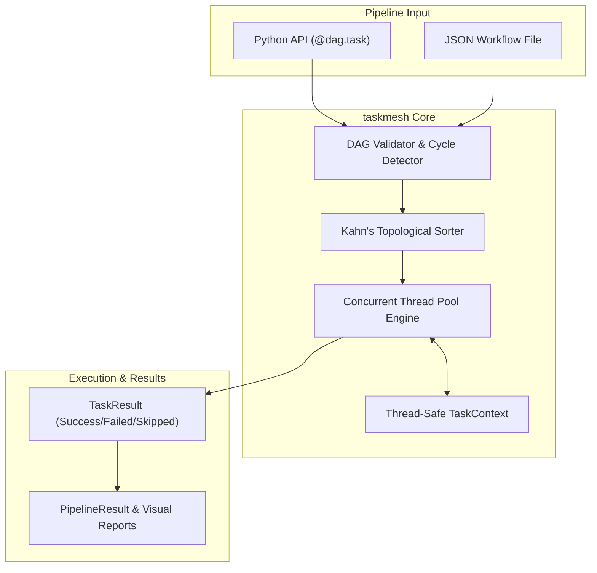

# taskmesh

<p align="center">
  <strong>Lightweight, zero-dependency directed acyclic graph (DAG) task orchestration and pipeline execution engine for Python.</strong>
</p>

<p align="center">
  
  
  
  
</p>

---

## Overview

Modern data processing, build automation, CI/CD runners, and micro-workflows frequently require executing tasks in strict dependency order with parallel concurrency. However, enterprise workflow frameworks like Apache Airflow, Luigi, Celery, or Prefect require heavy external dependencies, databases, message brokers, and background daemon services.

**`taskmesh`** provides a complete, robust DAG execution engine in **pure standard library Python** with zero third-party dependencies.

### Key Capabilities

- **Zero External Dependencies**: Runs anywhere Python 3.9+ is available. No extra packages needed.
- **Topological Scheduling**: Deterministic Kahn's algorithm resolution with cycle detection that traces circular dependencies.
- **Concurrent Worker Pool**: Multi-threaded execution across independent task branches using `ThreadPoolExecutor`.
- **Fault-Tolerant Resilience**:
  - Exponential backoff retries with configurable delay and multipliers.
  - Per-task timeout enforcement.
  - Flexible error policies (`ABORT`, `CONTINUE`, `IGNORE`).
- **Dynamic Context Passing**: Downstream tasks receive a unified, thread-safe `TaskContext` carrying results from upstream tasks.
- **Dual Declaration Interface**: Declare pipelines programmatically with Python decorators (`@dag.task`) or via declarative JSON files.
- **Visual Graph Rendering**: Export pipeline graphs to Graphviz DOT syntax or terminal-friendly ASCII trees.
- **Production CLI**: Inspect, validate, graph, and execute pipelines directly from the terminal.

---

## Installation

```bash
git clone https://github.com/mrhamidrezam/taskmesh.git
cd taskmesh
pip install .
```

---

## Quickstart

### 1. Programmatic Python API

```python
from taskmesh import DAG, Engine, ErrorPolicy

# 1. Initialize DAG
dag = DAG("analytics_pipeline", description="Daily metrics calculation")

# 2. Register tasks with dependencies
@dag.task()
def extract_sales(ctx):
    return [120, 450, 310, 890]

@dag.task()
def extract_costs(ctx):
    return [80, 200, 150, 400]

@dag.task(dependencies=["extract_sales", "extract_costs"])
def compute_profit(ctx):
    sales = sum(ctx.get("extract_sales"))
    costs = sum(ctx.get("extract_costs"))
    return {"net_revenue": sales, "total_cost": costs, "profit": sales - costs}

@dag.task(dependencies=["compute_profit"], retries=2, retry_delay=0.1)
def generate_report(ctx):
    summary = ctx.get("compute_profit")
    return f"Profit: ${summary['profit']} on ${summary['net_revenue']} revenue."

# 3. Execute concurrently with Engine
engine = Engine(max_workers=4)
result = engine.run(dag)

print(f"Status:  {'SUCCESS' if result.success else 'FAILED'}")
print(f"Report:  {result.get('generate_report')}")
```

### 2. Declarative JSON Pipelines

Create a file named `pipeline.json`:

```json
{
  "name": "data_pipeline",
  "tasks": [
    {
      "name": "download_data",
      "type": "python",
      "expr": "{'items': [10, 20, 30]}"
    },
    {
      "name": "process_data",
      "type": "python",
      "dependencies": ["download_data"],
      "code": "items = ctx.get('download_data')['items']; result = [x * 2 for x in items]"
    },
    {
      "name": "notify",
      "type": "shell",
      "dependencies": ["process_data"],
      "command": "python -c \"print('Pipeline Completed Successfully!')\""
    }
  ]
}
```

Run it via the CLI:

```bash
# Validate graph structure & detect cycles
taskmesh validate pipeline.json

# View ASCII dependency graph
taskmesh graph pipeline.json

# Execute pipeline
taskmesh run pipeline.json --workers 4
```

---

## Architecture



For complete architectural details, see [docs/ARCHITECTURE.md](docs/ARCHITECTURE.md).

---

## CLI Reference

`taskmesh` includes a built-in CLI:

| Command | Arguments | Description |
| :--- | :--- | :--- |
| `taskmesh run` | `<file> [-w WORKERS] [--json-output] [--strict]` | Executes a pipeline and outputs step-by-step progress or JSON results. |
| `taskmesh validate` | `<file>` | Checks pipeline for missing dependencies or cyclic relationships. |
| `taskmesh graph` | `<file> [-f ascii\|dot]` | Generates an ASCII tree or Graphviz DOT diagram of the task DAG. |
| `taskmesh --version` | | Displays current version. |

---

## Development & Testing

Run all unit tests using `pytest`:

```bash
python -m pytest tests -v
```

See [docs/SETUP.md](docs/SETUP.md) for full setup instructions.

---

## Comparison

| Feature | taskmesh | Celery | Airflow |
| :--- | :---: | :---: | :---: |
| **Dependencies** | **0 (Standard Library)** | Heavy (Redis/RabbitMQ, etc.) | Heavy (PostgreSQL, Webserver, etc.) |
| **Setup Time** | **< 1 minute** | Hours | Hours/Days |
| **DAG Concurrency** | Yes (Thread Pool) | Yes (Distributed) | Yes (Distributed) |
| **Cycle Detection** | Kahn's Algorithm + Tracing | Graph analysis | DAG validation |
| **JSON Workflow Support** | Native Built-in | Custom | Custom |
| **Ideal For** | Embedded pipelines, CLI tools, scripts, CI/CD | Distributed background workers | Enterprise-scale multi-system orchestration |

---

## License

This project is licensed under the [MIT License](LICENSE).
