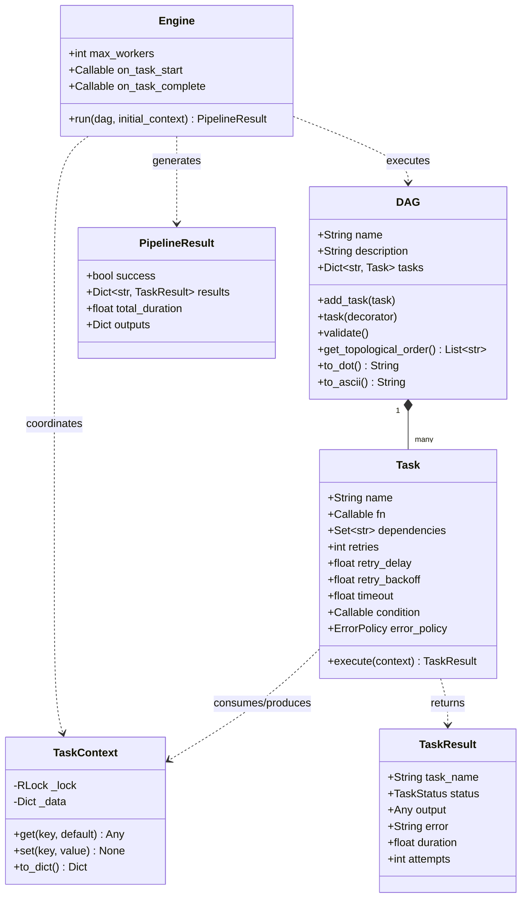
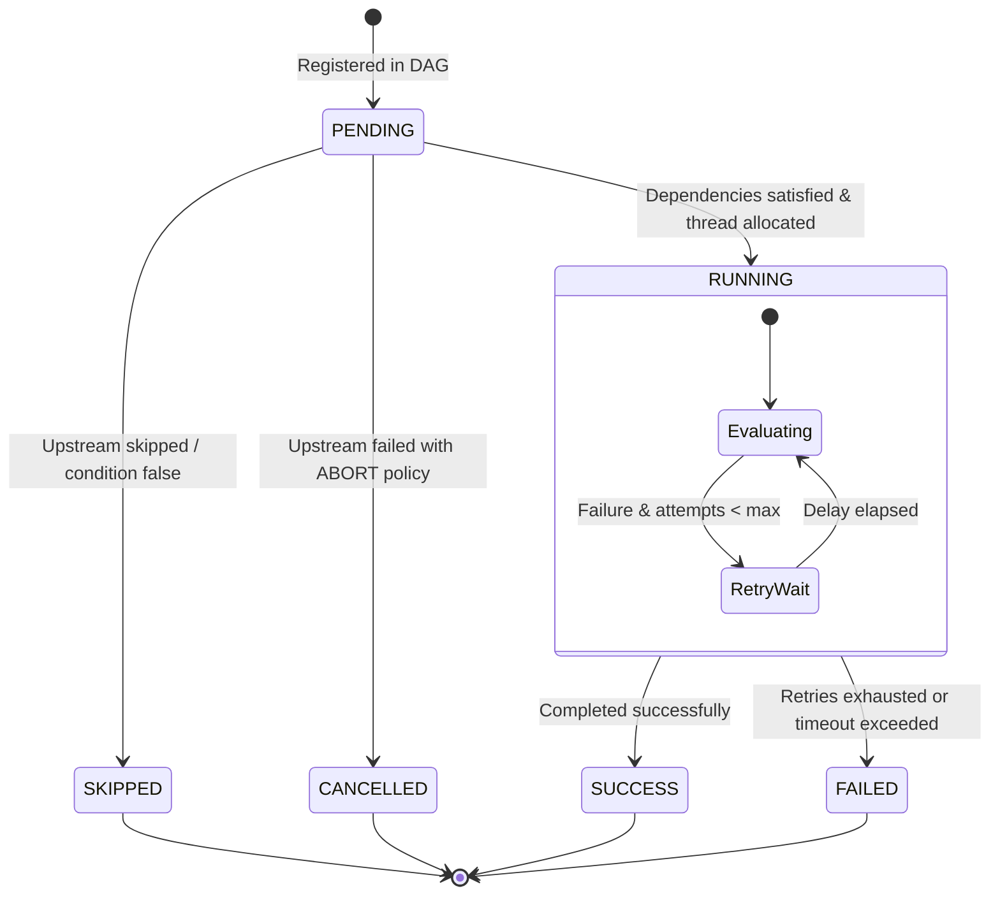

# taskmesh Architecture Guide

`taskmesh` is designed as a modern, lightweight, zero-dependency DAG (Directed Acyclic Graph) orchestration and execution engine for Python 3.9+.

This document describes the architectural principles, component interactions, execution lifecycle, and concurrency guarantees that govern `taskmesh`.

---

## 1. Design Principles

1. **Zero External Dependencies**: Powered entirely by the Python standard library (`concurrent.futures`, `dataclasses`, `typing`, `json`, `subprocess`, `urllib`).
2. **Deterministic Topological Scheduling**: Graph execution strictly respects dependencies using Kahn's algorithm and depth-first cycle verification.
3. **Thread-Safe Concurrency**: Independent task branches run simultaneously across worker thread pools without race conditions.
4. **Resilient Failure Control**: Pluggable error policies (`ABORT`, `CONTINUE`, `IGNORE`), per-task exponential backoff retries, and execution timeouts.
5. **Universal Interface**: Full parity between declarative definitions (JSON) and programmatic Python code (`@dag.task`).

---

## 2. System Overview & Component Hierarchy



---

## 3. Task Lifecycle State Machine

Each task transitions through well-defined lifecycle states:



---

## 4. Concurrency & Scheduling Engine

`taskmesh.engine.Engine` drives asynchronous execution through an event-loop-style worker dispatcher:

1. **Graph Validation**: Prior to running, the engine verifies that:
   - All referenced dependencies exist in the DAG.
   - The graph is completely acyclic (cycles trigger `CycleError` with the exact path).
2. **Ready Task Queue**: At any given step, tasks whose dependencies are fully satisfied and that are not already finished or in-flight are scheduled into the `ThreadPoolExecutor`.
3. **Context Synchronization**: All successful outputs are recorded in a thread-safe `TaskContext` guarded by a recursive mutex (`threading.RLock`).
4. **Deadlock & Cycle Protection**: If no threads are active and no tasks are ready while unvisited nodes remain, unfulfillable nodes are safely marked as `SKIPPED`.

---

## 5. Error Policies

| Policy | Behavior |
| :--- | :--- |
| **`ErrorPolicy.ABORT`** *(Default)* | Halts pipeline immediately. Cancels all pending futures and marks unstarted nodes as `CANCELLED`. |
| **`ErrorPolicy.CONTINUE`** | Marks all transitive descendants of the failed node as `SKIPPED`. Continues executing independent parallel branches to completion. |
| **`ErrorPolicy.IGNORE`** | Marks the task as failed but satisfies dependencies for downstream consumers, allowing pipeline execution to continue uninterrupted. |

---

## 6. Serialization & File Formats

`taskmesh.loader` provides first-class support for loading JSON pipeline definitions:

```json
{
  "name": "example_pipeline",
  "tasks": [
    {
      "name": "step_a",
      "type": "python",
      "expr": "42"
    },
    {
      "name": "step_b",
      "type": "shell",
      "dependencies": ["step_a"],
      "command": "echo 'Received: {{ step_a }}'"
    }
  ]
}
```

The template engine automatically parses and replaces `{{ key }}` expressions using live values from the executing pipeline context.
